# DeepFinder — OSINT & Threat Intelligence Platform

<p align="center">
  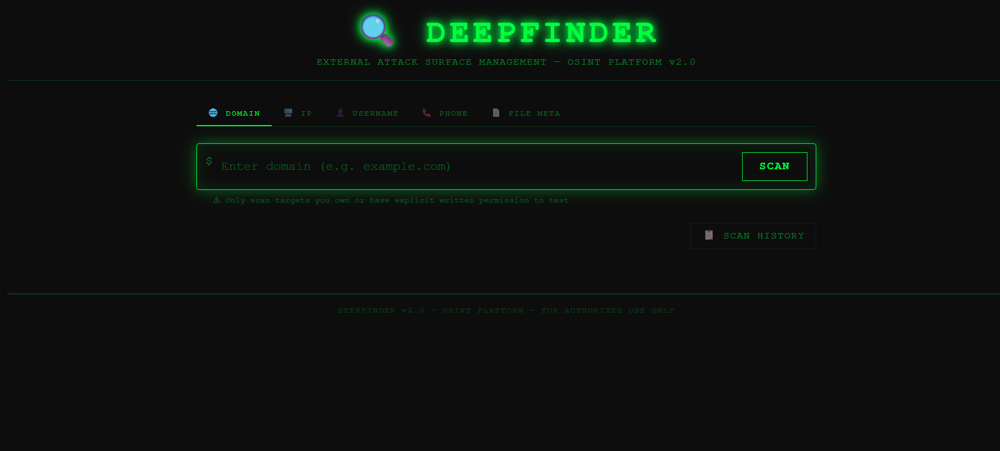
</p>

<p align="center">
  
  
  
  
  
  
  
</p>

<p align="center">
  <strong>DeepFinder</strong> is an automated External Attack Surface Management (EASM) and Open Source Intelligence (OSINT) platform. Designed for security analysts, penetration testers, and defensive security teams, it unifies digital footprinting, domain reconnaissance, multi-source threat score aggregation, and leaked metadata extraction into an intuitive cyber-terminal web interface.
</p>

---

## 📸 Visual Showcase & Platform Interfaces

### 1. Cyber-Terminal Landing & Ethical Warning
Interactive command-center entrypoint with real-time target input and ethical use disclaimers.
<p align="center">
  
</p>

### 2. Main Security Dashboard & Dynamic Risk Score
Executive risk overview displaying real-time aggregated threat score, severity level, domain registration parameters, and DNS records.
<p align="center">
  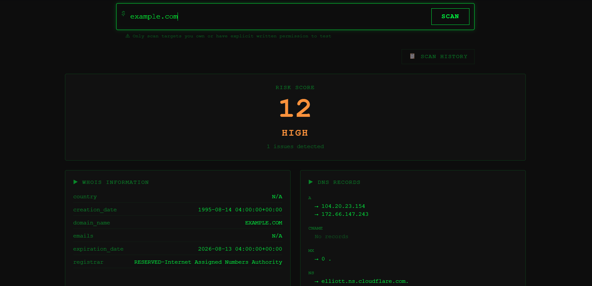
</p>

### 3. Network Reconnaissance & Port Scanning
Comprehensive network audit aggregating WHOIS metadata, DNS records (`A`, `MX`, `NS`, `TXT`, `CNAME`), IP geolocation, and open port enumeration.
<p align="center">
  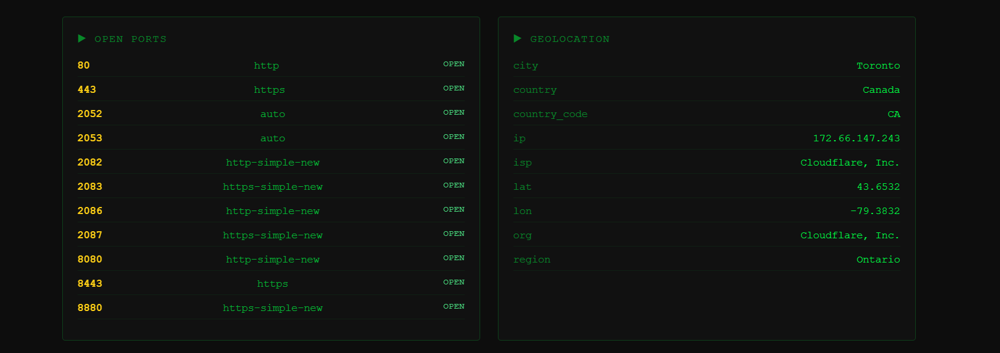
</p>

### 4. Multi-Source Threat Intelligence Telemetry
Real-time verdict aggregation from industry threat feeds: VirusTotal engine detections, AbuseIPDB confidence scores, AlienVault OTX pulses, and URLScan analysis.
<p align="center">
  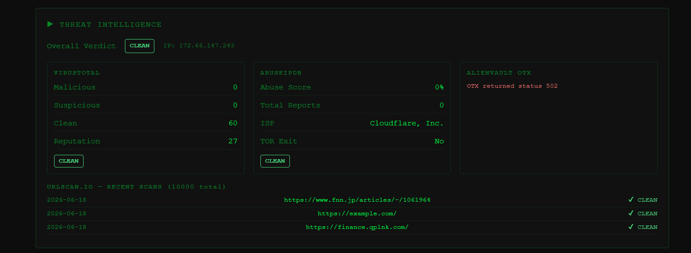
</p>

### 5. Security Headers & Technology Fingerprinting
Evaluation of HTTP security posture (`CSP`, `HSTS`, `X-Frame-Options`, `X-Content-Type-Options`) alongside automatic detection of CMS, web servers, and backend frameworks.
<p align="center">
  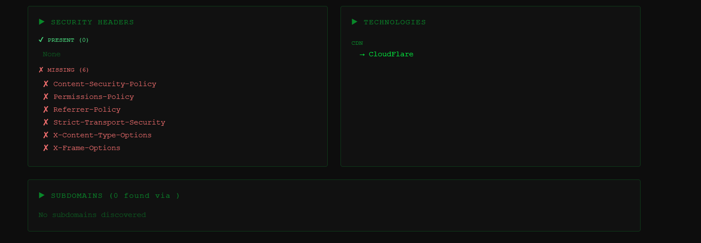
</p>

### 6. Corporate Intelligence & Exposed Assets
Automated company profiling via AbstractAPI (industry classification, physical headquarters, employee estimates) combined with Google dorking for sensitive exposed files (`.pdf`, `.xlsx`, `.env`).
<p align="center">
  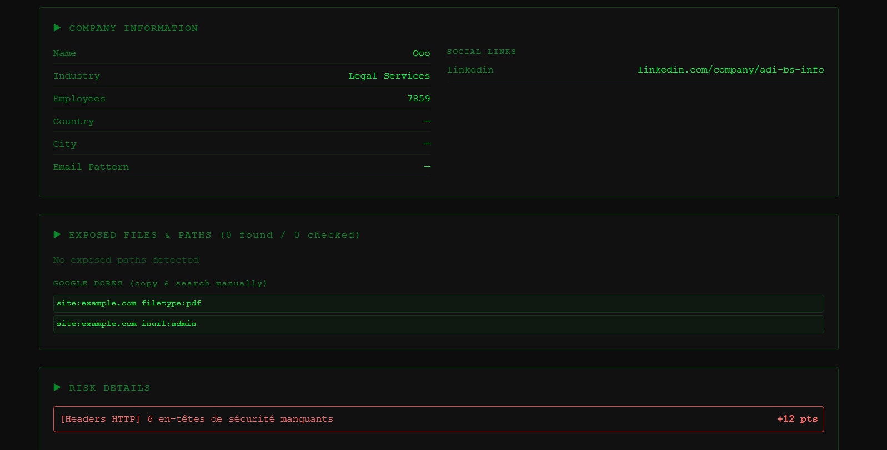
</p>

---

## 🔍 Specialized OSINT Investigation Modules

| Module | Description | Screenshot Preview |
|:---|:---|:---:|
| **Social Lookup** | Scans 16+ platforms (GitHub, GitLab, Instagram, Reddit, Twitch, Twitter/X, etc.) for target usernames. | 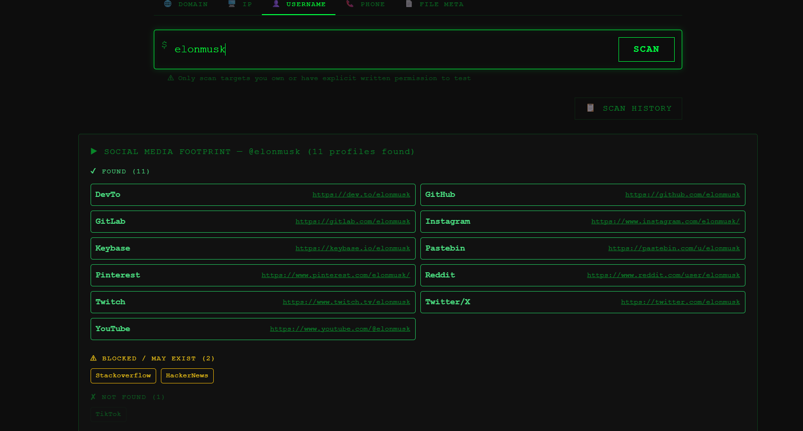 |
| **File Metadata Extraction** | FOCA-style metadata extraction from public documents (`PDF`, `DOCX`, `XLSX`, images) detecting author signatures, software versions, and EXIF data. | 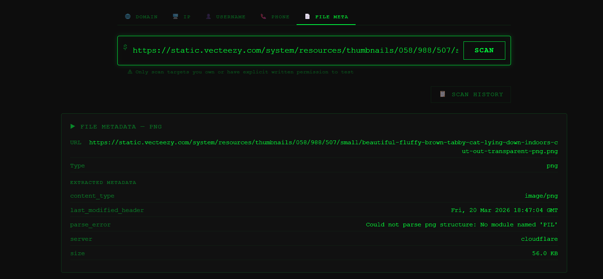 |
| **Phone Number Validation** | Derives international E.164 formatting, carrier name, country of origin, and telecom line type (Mobile, VoIP, Landline). | 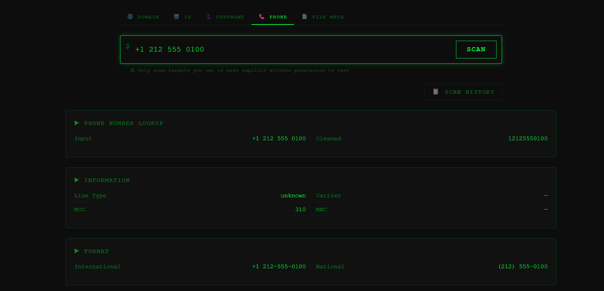 |
| **IP Address Scanner** | Deep IP reputation audit with abuse metrics, blacklist verification, and ISP attribution. | 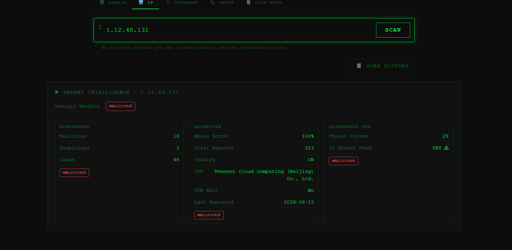 |
| **Scan History Archive** | Local SQLite storage archiving past reconnaissance operations for rapid comparison, auditability, and tracking. | 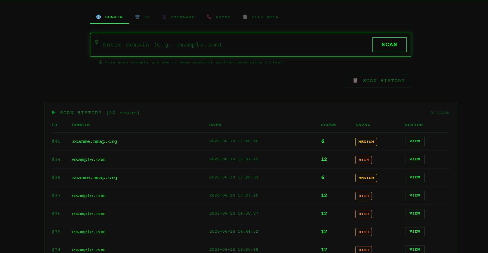 |
| **Detailed Threat Intel** | Deep-dive telemetry showing individual URL scan results, domain categorizations, and indicator verdicts. | 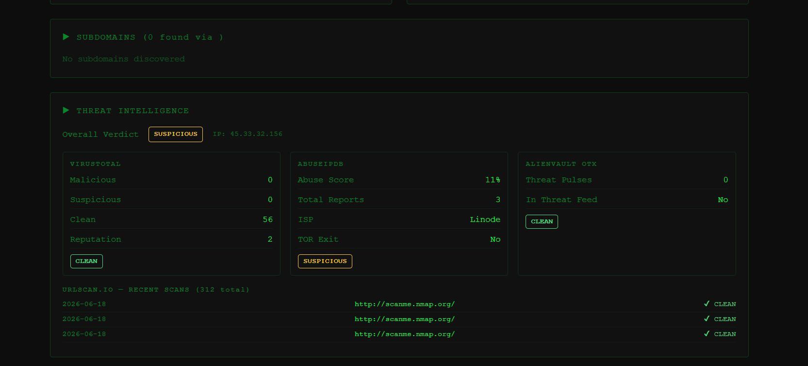 |

---

## 📐 Architecture & System Modeling

DeepFinder follows a modular full-stack architecture adhering to defensive engineering standards:

### 1. Global System Architecture
<p align="center">
  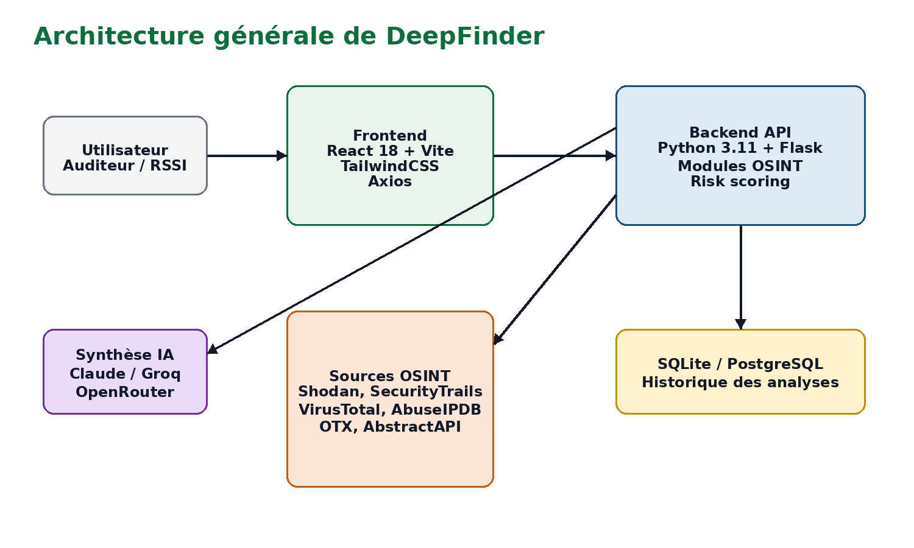
</p>

### 2. Processing Pipeline & Data Flow
<p align="center">
  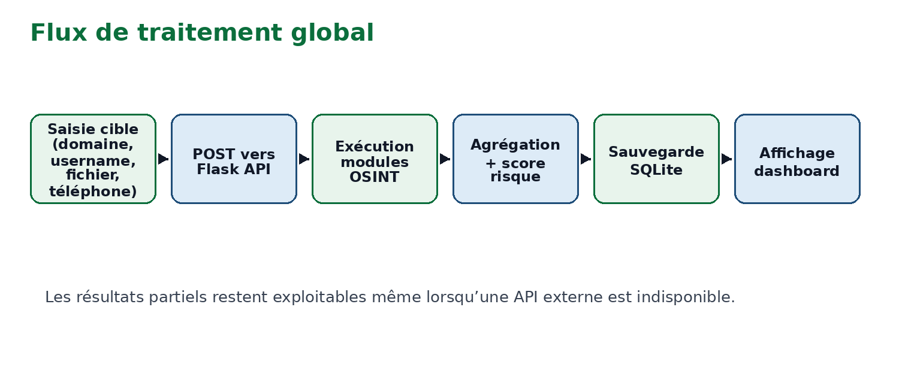
</p>

### 3. Use Case & Sequence Diagrams
| Use Case Diagram | Domain Analysis Sequence | Simplified Data Model |
|:---:|:---:|:---:|
| 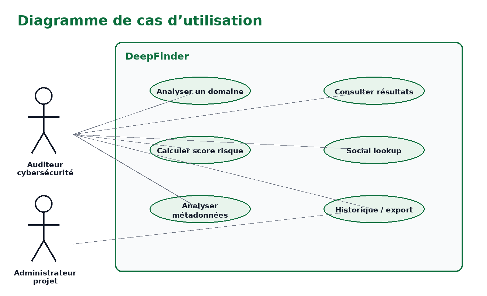 | 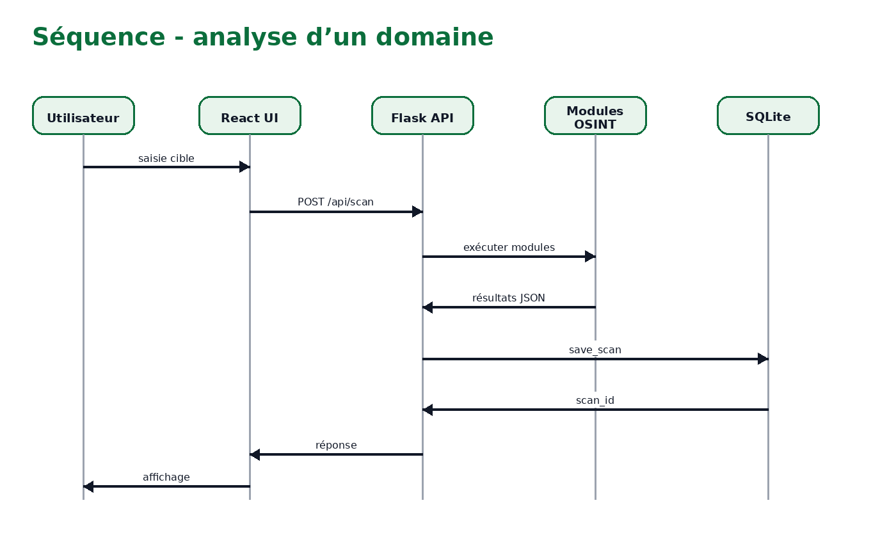 | 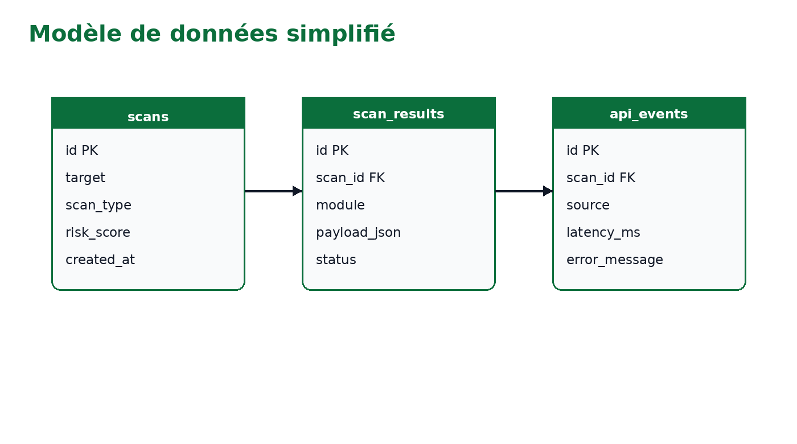 |

---

## 🛠️ Tech Stack

- **Backend :** Python 3.10+, Flask 3.x, Requests, Dnspython, Python-Whois, Shodan SDK, Pillow, PyPDF, Python-Docx, Openpyxl.
- **Frontend :** React 19, Vite 8, TailwindCSS 3.x, Axios, Lucide Icons.
- **Database :** SQLite (local persistence for scans and threat history).
- **APIs & Feeds :** Shodan, VirusTotal, AbuseIPDB, AlienVault OTX, URLScan.io, AbstractAPI, IP-API.

---

## 📁 Repository Structure

```text
Solution-OSINT-Tool-Project/
├── backend/
│   ├── modules/
│   │   ├── company_lookup.py     # AbstractAPI company profiling
│   │   ├── dns_lookup.py         # DNS resolution (A, MX, TXT, NS, CNAME)
│   │   ├── file_metadata.py      # PDF, DOCX, XLSX & EXIF metadata parser
│   │   ├── geo_lookup.py         # IP geolocation service
│   │   ├── headers.py            # HTTP security headers auditor
│   │   ├── phone_lookup.py       # Phone carrier & line validation
│   │   ├── port_scanner.py       # Socket-based non-intrusive port scanner
│   │   ├── risk.py               # Algorithmic risk index calculation
│   │   ├── social_lookup.py      # Multi-platform username footprinting
│   │   ├── subdomains.py         # Passive subdomain discovery handler
│   │   ├── tech_detector.py      # Web technology & CMS detection
│   │   ├── threat_intel.py       # VirusTotal, AbuseIPDB, OTX aggregator
│   │   └── whois_lookup.py       # WHOIS protocol querying
│   ├── App.py                    # Flask application & REST API routes
│   ├── database.py               # SQLite database setup & queries
│   ├── requirements.txt          # Python backend dependencies
│   └── .env.example              # Sample API configuration
├── frontend/
│   ├── src/
│   │   ├── App.jsx               # Terminal cyber UI & state manager
│   │   ├── App.css               # Dashboard theme styling
│   │   ├── index.css             # Tailwind CSS entrypoint
│   │   └── main.jsx              # React DOM mounting
│   ├── package.json              # React dependencies & scripts
│   ├── tailwind.config.js        # Tailwind styling configuration
│   └── vite.config.js            # Vite build configuration
├── docs/
│   └── screenshots/              # UI screenshots & architectural diagrams
├── .gitignore                    # Git ignore file
└── README.md                     # Documentation
```

---

## 🚀 Getting Started

### Prerequisites
- **Python 3.10+**
- **Node.js 18+** & npm / yarn

### Backend Setup
1. Navigate to the backend directory:
   ```bash
   cd backend
   ```
2. Create and activate a virtual environment:
   ```bash
   python -m venv venv
   # Windows:
   venv\Scripts\activate
   # Linux / macOS:
   source venv/bin/activate
   ```
3. Install dependencies:
   ```bash
   pip install -r requirements.txt
   ```
4. Set up environment variables:
   ```bash
   cp .env.example .env
   ```
5. Start the Flask server:
   ```bash
   python App.py
   ```
   Backend will be running on `http://127.0.0.1:5000`.

### Frontend Setup
1. Navigate to the frontend directory:
   ```bash
   cd frontend
   ```
2. Install dependencies:
   ```bash
   npm install
   ```
3. Start the development server:
   ```bash
   npm run dev
   ```
   Open your browser at `http://localhost:5173`.

---

## 🔑 API Keys Configuration

While core footprinting functions (WHOIS, DNS, ports, headers, and geolocation) run out of the box without keys, you can provide free API credentials in `backend/.env` for enriched telemetry:

| Provider | Purpose | Free Tier Availability | Environment Variable |
| :--- | :--- | :--- | :--- |
| **VirusTotal** | Threat detection & domain reputation | 500 req/day (4 req/min) | `VIRUSTOTAL_API_KEY` |
| **AbuseIPDB** | IP reputation & abuse reporting | 1,000 req/day | `ABUSEIPDB_API_KEY` |
| **AlienVault OTX** | Threat intelligence pulses | Free with account | `OTX_API_KEY` |
| **URLScan.io** | URL and site behavior scans | 100 scans/hour | `URLSCAN_API_KEY` |
| **AbstractAPI** | Company & phone data enrichment | Free trial credits | `ABSTRACT_COMPANY_API_KEY`, `ABSTRACTAPI_PHONE_KEY` |

---

## ⚖️ Legal & Ethical Disclaimer

> [!CAUTION]
> **Strictly for Authorized Educational & Defensive Purposes**:
> DeepFinder is developed strictly for legitimate defensive security analysis, authorized footprinting, and educational research. Scanning targets without explicit authorization may violate applicable laws and terms of service. Users are solely responsible for ensuring their scans comply with all legal regulations.

---

## 📄 License

This project is licensed under the [MIT License](LICENSE).
