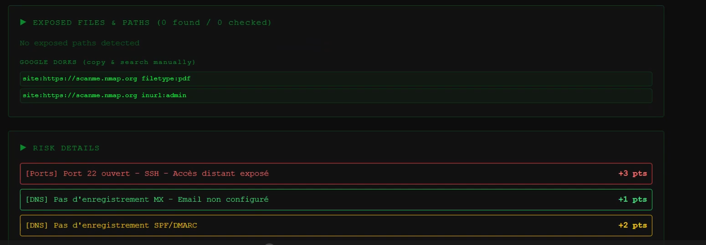

# DeepFinder — OSINT & Threat Intelligence Platform

<p align="center">
  
  
  
  
  
  
  
</p>

<p align="center">
  <strong>DeepFinder</strong> is an all-in-one Open Source Intelligence (OSINT) and Threat Intelligence reconnaissance platform. Designed for security analysts, penetration testers, and OSINT researchers, it unifies digital footprinting, domain reconnaissance, threat score aggregation, and leaked metadata extraction into an intuitive cyber-terminal web interface.
</p>

<p align="center">
  
</p>

---

## Key Features

### 🌐 1. Domain & Network Reconnaissance
- **WHOIS Inspection**: Domain registration dates, registrar details, administrative contacts, and expiration timestamps.
- **DNS Record Enumeration**: Resolves records for `A`, `MX`, `TXT`, `NS`, and `CNAME`.
- **Port Scanner**: Rapid scanning of essential network ports (`21`, `22`, `80`, `443`, `3306`, `8080`, etc.).
- **Security Headers Analysis**: Evaluates HTTP response headers (`HSTS`, `CSP`, `X-Frame-Options`, `X-Content-Type-Options`).
- **Tech Stack Profiling**: Detects underlying CMS, web servers, frameworks, and script libraries.
- **IP Geolocation**: Pinpoints country, region, city, coordinates, and ASN data.
- **Dynamic Risk Score**: Calculates an overall risk index and grade based on exposed ports, missing headers, and registration metrics.

### 🛡️ 2. Multi-Source Threat Intelligence
- Correlates domain and IP reputation data across top threat intelligence feeds:
  - **VirusTotal**: Malicious and suspicious engine detections.
  - **AbuseIPDB**: Abuse confidence score and community incident reports.
  - **AlienVault OTX**: Threat pulses and targeted indicators of compromise (IoCs).
  - **URLScan.io**: Visual domain scan and malicious verdict telemetry.
- Delivers a unified **CLEAN**, **SUSPICIOUS**, or **MALICIOUS** verdict.

### 🏢 3. Corporate & Organization Intelligence
- Company profiling via AbstractAPI.
- Enriches domain names with business names, estimated employee headcounts, industry categorizations, physical headquarters, and social links.

### 👤 4. Social & Username Footprinting
- Scans common platforms, developer portals, and social channels for existing usernames.
- Quick verification of digital identity footprints across the web.

### 📞 5. Phone Number Intelligence
- Derives legitimate, publicly available information: validity, international E.164 formatting, carrier name, country, and line type (VoIP, Mobile, Landline).
- Helps evaluate telecom origin without invasive private searches.

### 📄 6. Document & Metadata Extraction
- FOCA/Metagoofil-style analysis for public documents and assets (`PDF`, `DOCX`, `XLSX`, images).
- Extracts author usernames, software versions, creation/modification dates, EXIF hardware signatures, and embedded GPS coordinates.

### 📊 7. SQLite Scan History
- Automatically archives completed scans into a lightweight SQLite database for auditing, comparison, and post-engagement reporting.

---

## Architecture & Project Structure

```text
Solution-OSINT-Tool-Project/
├── backend/
│   ├── modules/
│   │   ├── company_lookup.py     # AbstractAPI company intelligence
│   │   ├── dns_lookup.py         # DNS resolution module
│   │   ├── file_metadata.py      # PDF, DOCX, XLSX & EXIF metadata parser
│   │   ├── geo_lookup.py         # IP geolocation service
│   │   ├── headers.py            # HTTP security header auditing
│   │   ├── phone_lookup.py       # Phone carrier & line validation
│   │   ├── port_scanner.py       # Socket-based port scanner
│   │   ├── risk.py               # Risk scoring algorithm
│   │   ├── social_lookup.py      # Username footprinting
│   │   ├── subdomains.py         # Subdomain discovery handler
│   │   ├── tech_detector.py      # Web technology detection
│   │   ├── threat_intel.py       # VirusTotal, AbuseIPDB, OTX aggregator
│   │   └── whois_lookup.py       # WHOIS protocol querying
│   ├── App.py                    # Flask application & API routes
│   ├── database.py               # SQLite database setup & queries
│   ├── requirements.txt          # Python backend dependencies
│   └── .env.example              # Sample API configuration
├── frontend/
│   ├── src/
│   │   ├── App.jsx               # Terminal-style cyber UI & state manager
│   │   ├── App.css               # Dashboard theme styling
│   │   ├── index.css             # Tailwind CSS entrypoint
│   │   └── main.jsx              # React DOM mounting
│   ├── package.json              # React dependencies & scripts
│   ├── tailwind.config.js        # Tailwind styling configuration
│   └── vite.config.js            # Vite build configuration
├── image.png                     # Platform preview screenshot
├── .gitignore                    # Git ignore file
└── README.md                     # Documentation
```

---

## API Endpoints Reference

| Method | Endpoint | Description |
| :--- | :--- | :--- |
| `GET` | `/` | Health check & API version information |
| `POST` | `/api/scan` | Performs full domain OSINT & security audit |
| `POST` | `/api/threat` | Queries VirusTotal, AbuseIPDB, and OTX for an IP or domain |
| `POST` | `/api/company` | Fetches corporate intelligence via AbstractAPI |
| `POST` | `/api/social` | Footprints a username across social platforms |
| `POST` | `/api/phone` | Validates a phone number and identifies carrier & line type |
| `POST` | `/api/files/metadata` | Extracts embedded metadata from a file URL |
| `GET` | `/api/history` | Retrieves all previously saved scans |
| `GET` | `/api/scan/<id>` | Retrieves specific scan results by ID |

---

## Getting Started

### Prerequisites

- **Python**: 3.10 or higher
- **Node.js**: 18.0 or higher
- **npm** or **yarn**

---

### Backend Setup

1. **Navigate to the backend directory**:
   ```bash
   cd backend
   ```

2. **Create and activate a virtual environment**:
   - **Windows**:
     ```bash
     python -m venv venv
     venv\Scripts\activate
     ```
   - **macOS / Linux**:
     ```bash
     python3 -m venv venv
     source venv/bin/activate
     ```

3. **Install dependencies**:
   ```bash
   pip install -r requirements.txt
   ```

4. **Configure environment variables**:
   Create a `.env` file from the example:
   ```bash
   cp .env.example .env
   ```
   Add your optional API keys for enhanced threat intelligence (see [API Configuration](#api-configuration) below).

5. **Start the Flask server**:
   ```bash
   python App.py
   ```
   The backend will be available at `http://127.0.0.1:5000`.

---

### Frontend Setup

1. **Navigate to the frontend directory**:
   ```bash
   cd frontend
   ```

2. **Install node dependencies**:
   ```bash
   npm install
   ```

3. **Launch the development server**:
   ```bash
   npm run dev
   ```
   Open your browser and navigate to `http://localhost:5173`.

---

## API Configuration

While core features (WHOIS, DNS, ports, headers, and geolocation) work without external keys, you can provide free API keys in `backend/.env` for enriched reconnaissance:

| Provider | Purpose | Free Tier Availability | Environment Variable |
| :--- | :--- | :--- | :--- |
| **VirusTotal** | Threat detection & domain reputation | 500 req/day (4 req/min) | `VIRUSTOTAL_API_KEY` |
| **AbuseIPDB** | IP reputation & abuse reporting | 1,000 req/day | `ABUSEIPDB_API_KEY` |
| **AlienVault OTX** | Threat intelligence pulses | Free with account | `OTX_API_KEY` |
| **URLScan.io** | URL and site behavior scans | 100 scans/hour | `URLSCAN_API_KEY` |
| **AbstractAPI** | Company & phone data enrichment | Free trial credits | `ABSTRACT_COMPANY_API_KEY`, `ABSTRACTAPI_PHONE_KEY` |

---

## Authors & Credits

Developed by:
- **Aymane Bouras** — [@LibrarianPoms](https://github.com/LibrarianPoms)
- **Omar Chouri**

---

## Legal & Ethical Disclaimer

> [!CAUTION]
> **For Authorized Educational & Defensive Purposes Only**:
> This tool is developed strictly for legitimate security analysis, defensive auditing, and educational research. Running scans against networks, hosts, or entities without explicit prior authorization may violate local laws and terms of service. The authors assume no liability for misuse of this software.

---

## License

This project is licensed under the [MIT License](LICENSE).
